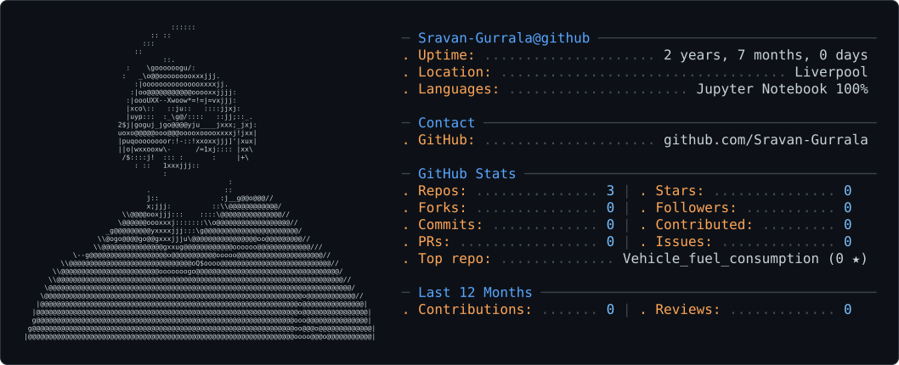

# Sravan Gurrala
### IT Support · ServiceNow · Process Automation

MSc Data Science and Artificial Intelligence graduate from the University of Liverpool, focused on IT Support, Service Desk and junior ServiceNow opportunities.

I build practical ServiceNow projects in a Personal Developer Instance, covering request fulfilment, incident routing, access controls and data imports. My Python projects demonstrate data analysis and problem-solving skills.

**Liverpool, UK · Open to relocation across the UK**

## Featured work

### [ServiceNow portfolio](https://github.com/Sravan-Gurrala/servicenow-portfolio)
Four practical projects with implementation notes and screenshots. Employee Onboarding and Incident Automation also include exported update sets.

| Project | What it demonstrates |
| --- | --- |
| [Employee Onboarding](https://github.com/Sravan-Gurrala/servicenow-portfolio/tree/main/project-1-employee-onboarding) | Catalog forms, manager approvals, HR/IT tasks and conditional hardware requests |
| [Incident Automation](https://github.com/Sravan-Gurrala/servicenow-portfolio/tree/main/project-2-incident-automation) | Assignment rules, Business Rules, client-side guidance and SLA configuration |
| [Leave Management](https://github.com/Sravan-Gurrala/servicenow-portfolio/tree/main/project-3-leave-management) | Scoped application, custom tables, ACLs and form/data policies |
| [IT Asset Requests & Data Import](https://github.com/Sravan-Gurrala/servicenow-portfolio/tree/main/project-4-it-asset-portal) | Record Producers, Order Guides, Transform Maps and Coalesce |

## Technical toolkit

- **ServiceNow:** Service Catalog, Flow Designer, Business Rules, Client Scripts, UI Policies, ACLs, SLAs, Import Sets and Update Sets.
- **Data:** Python, SQL, pandas, NumPy, scikit-learn, Matplotlib and Seaborn.
- **Working approach:** Clear documentation, structured troubleshooting and practical testing.

## Supporting data projects

- [Customer Churn Prediction](https://github.com/Sravan-Gurrala/Customer-Churn-Prediction) — exploratory analysis and comparison of four classification models.
- [Vehicle Fuel Consumption](https://github.com/Sravan-Gurrala/Vehicle_fuel_consumption) — Auto MPG analysis, preprocessing and regression experiments.

GitHub profile card

<picture>
  <source media="(prefers-color-scheme: dark)" srcset="dark_mode.svg" />
  <source media="(prefers-color-scheme: light)" srcset="light_mode.svg" />
  
</picture>

